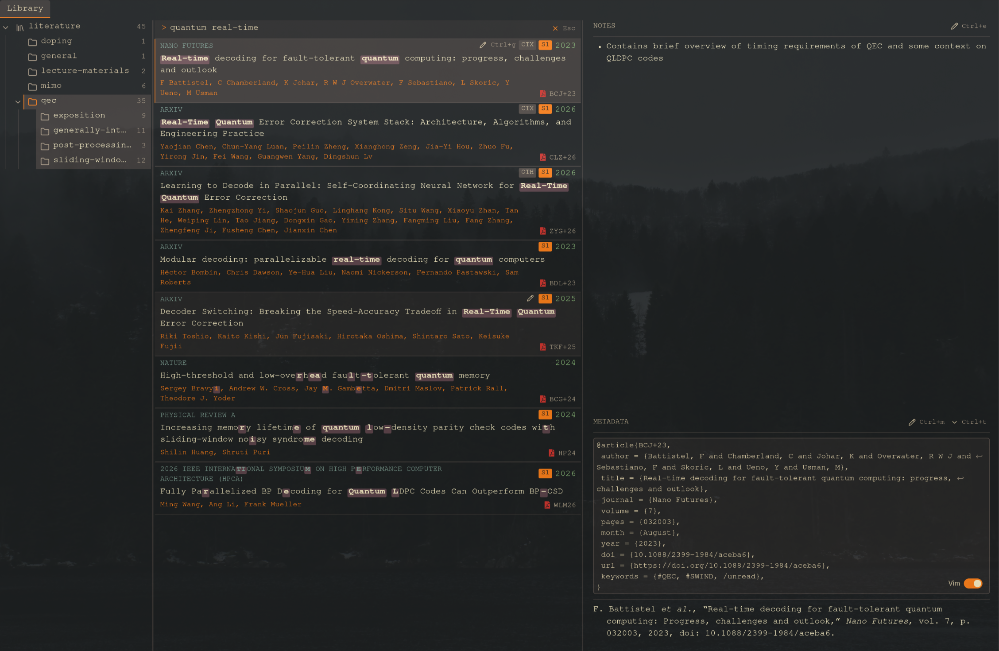

<div align="center">
    <br>
    <!-- <br> -->
    <br>
    A lightweight iterature library manager built with Tauri, Rust, and React.
</div>

</br>



> This project is still in an alpha state. This means that
> - the usage experience, especially with regard to configuration, can be a bit rough around the edges,
> - all parts are subject to breaking changes,
> - more features are under active development.

- Fuzzily search titles, authors, dates, and publishers with [fzf](https://www.npmjs.com/package/fzf)
- Assign tags with custom colors and make notes in markdown
- Configure the app via `lua` (see the [configuration section](#usage--configuration) below)
    - vim-like keymap system, allowing full navigation of the UI via keyboard
    - support any bibliography format by defining custom parsers
- Transparent file storage structure (e.g., allowing use of `git` or [`rga`](https://github.com/phiresky/ripgrep-all))
    ```txt
    <library directory>
    │── collection 1
    │   ├── SAB21.bib
    │   ├── SAB21.pdf
    │   ├── KSW+25.bib
    │   └── KSW+25.pdf
    │           ...
    │   ├── notes.yml
    │   └── tags.yml
    └── collection 2
        ├── ALB20.bib
        ├── ALB20.pdf
        ├── BCG+24.bib
        ├── BCG+24.pdf
                ...
        ├── notes.yml
        └── tags.yml
    ```
- A host of other features
    - Edit citation data with live rendered citation preview
    - Instant UI updates when files change
    - Use with zotero connector to import publications
    - ...

<!-- TODO: Logo -->
<!-- TODO: Screenshots -->

## Development

```bash
$ bun install                                               # Initial setup
$ cargo tauri dev                                           # Run the app in development mode
$ cargo tauri build --no-bundle                             # Compile a release binary
$ cd src-tauri && cargo test                                # Run unit tests
$ cd src-tauri && cargo run --example generate_luals_addon  # Regenerate LuaLS addon after changin API
```

## Usage & Configuration

> Currently, no precompiled binaries are distributed. Check the
> [development section](#development) for instructions on how to compile and run
> the app.

### Configuration

Brittle reads its configuration from a Lua file at
`$XDG_CONFIG_HOME/brittle/init.lua` (on linux usually
`~/.config/brittle/init.lua`).
Example `init.lua`:

```
return {
    opts = {
        library_path = "/home/you/literature",
        library_ignore_patterns = {".git"},
        data_path = "/home/you/.local/share/brittle",
        pdf_viewer = "external",
        autosave_debounce_ms = 250,
        reference_preview_debounce_ms = 500,
        tag_colors = {
            S1 = { foreground = "var(--bg0)", background = "var(--accent7)" },
            BRD = { foreground = "#d3869b" },
        },
        watch = {
            -- Rescan the library when a reference file changes on disk
            {
                path = "/home/you/literature",
                action = {"library"},
                ignore = {".git"},
            },
            -- Re-evaluate this file when it is edited
            {
                path = "/home/you/.config/brittle/init.lua",
                action = {"config"},
            },
        },
    },
    ref_parsers = {
        {
            -- Parser for bibtex files
            file_extension = "bib",
            parser = function(src)
                local result = {}

                result.title = src:match("title%s*=%s*{(.-)}")
                result.publisher = src:match("journal%s*=%s*{(.-)}")
                result.year = tonumber(src:match("year%s*=%s*{(.-)}"))
                result.authors = src:match("author%s*=%s*{(.-)}")

                return result
            end,
            -- Optional. Rendered below the metadata editor. Only <i>, <b>,
            -- <u>, <sup> and <sub> are interpreted, anything else stays literal
            reference_preview = function(src)
                local authors = src:match("author%s*=%s*{(.-)}")
                local title = src:match("title%s*=%s*{(.-)}")
                local year = src:match("year%s*=%s*{(.-)}")

                return authors .. " (" .. year .. "). <i>" .. title .. "</i>"
                -- Or run, e.g., pandoc reference compilation
            end,
        },
    },
    commands = {
        { name = "echo", func = function(args) return args end },
    },
}
```

For a full list of configuration options consult `src-tauri/src/config.rs`
or `brittle-api-luals-addon/library/brittle.lua`.

### Luals addon

The `brittle-api-luals-addon/` directory contains EmmyLua type annotations for
all config types. These can be provided to a language server for
autocompletion and diagnostics when editing `init.lua`.

E.g., for [LuaLS](https://luals.github.io/), reference the addon from
`/path/to/your/config/.luarc.json`:

```
{
    "workspace.library": [
        "/path/to/checkout/brittle-api-luals-addon/library"
    ]
}
```

To make use of the type annotations, annotate the lua code:

```
-- @return Config
return { ... }
```
### Troubleshooting

If the UI feels laggy on Linux, try setting

```bash
$ export WEBKIT_DISABLE_DMABUF_RENDERER=1
```
